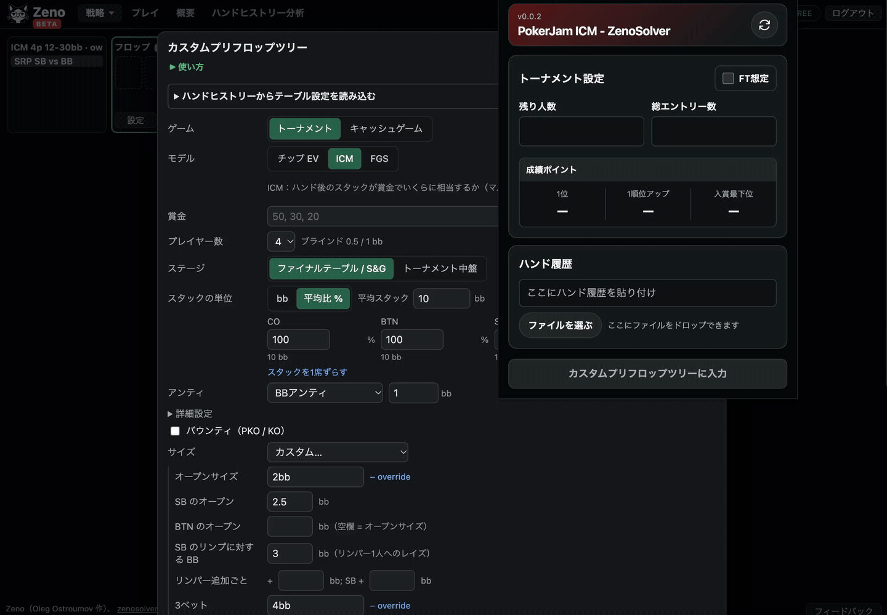

# PokerJam ICM - ZenoSolver

POKER Jamのトーナメントのハンド履歴を使い、ZenoSolverの「カスタムプリフロップ / ICM」にテーブル設定と賞金を入力するChrome拡張です。プレイ後の振り返りに使えます。

## Chromeへの追加

1. Chromeで `chrome://extensions` を開き、右上の「デベロッパー モード」をオンにします。
2. 「パッケージ化されていない拡張機能を読み込む」を押し、このプロジェクト内の `extension` フォルダを選びます。
3. Chromeのツールバーまたは拡張機能メニューで「PokerJam ICM - ZenoSolver」をクリックします。別のサイトにいる場合は、案内の「ZenoSolverを開く」を押し、開いたタブで拡張機能のアイコンをもう一度クリックします。

## GitHubから更新する

1. ポップアップ右上の更新ボタンを押し、新しい版が見つかったら「更新を適用する」を開きます。
2. 「フォルダを選んで更新」を押し、`chrome://extensions` の「詳細」にある読み込み元と同じ `extension` フォルダを選んで、Chromeに変更を許可します。
3. 拡張機能が再読み込みされたら、ポップアップ左上のバージョンを確認します。再読み込み時に、ポップアップに取り込んだハンド履歴は消えます。

Chrome Web Storeへの登録や、更新用アプリのインストールは不要です。フォルダへの書き込み許可は更新時にChromeで行います。開発用のGit作業コピーを使っている場合は、ファイルを別のフォルダにコピーしてから、Chromeでそのフォルダを読み込んでください。

「更新を適用する」がない旧版からは、一度だけ[リリース](https://github.com/NoasProject/PokerJam-ICM-ChromeExtensions/releases)の `extension` フォルダの中身を読み込み元にコピーし、`chrome://extensions` で再読み込みしてください。

## 使い方

1. Waitinglistアプリの「マイページ → POKER Jam」で、振り返りたいハンドのGTO Wizard向け履歴をコピーします。([POKER Jam公式ガイド](https://note.com/waitinglist/n/n6da9e128c960))
2. トーナメント設定で、全卓の残り人数とリエントリーを含む総エントリー数を入力します。「FT想定」をオンにすると、選んだハンドの着席人数が残り人数として表示されます。入力するのは総エントリー数だけです。画面に1位・順位差・入賞最下位の成績ポイントとITM人数が表示されます。
3. トーナメント設定の下にある「ここにハンド履歴を貼り付け」欄で ⌘V（Windowsでは Ctrl+V）を押します。UTF-8テキストファイルは、「ファイルを選ぶ」かドラッグ＆ドロップで取り込めます。複数ハンドが含まれる場合は、新しいハンドから順に並び、取り込み直後は最新のハンドが選ばれます。「表示するハンド」で切り替えると、残り人数の手入力が消え、席順、開始スタック、ブラインド、アンティが更新されます。「元の履歴」を開くと、カードやアクションも確認できます。
4. ZenoSolverで「戦略 → カスタムプリフロップ / ICM」を開きます。画面に「カスタムプリフロップツリー」が表示されたら、ポップアップの「カスタムプリフロップツリーに入力」を押します。同じタブで入力内容を確認し、「計算」を押します。([ZenoSolverのチュートリアル](https://zenosolver.com/tutorials/))

残り10人以上、または9人以下でも他卓にプレイヤーが残っている場合は、ステージを「トーナメント中盤」に設定します。現在のテーブルのスタックを必要な人数分だけ複製して、全体の平均スタックをBB単位で推定します。複製する人数が同卓の人数に満たない分は、スタックの大きい順に割り当てます。たとえば残り9人で同卓が5人なら、同卓の5人と最ショートを除いた4人分の平均を使います。ZenoSolverでは「残りプレイヤー数」と「現実的なばらつき」を選択し、実際の残り人数と推定した平均スタックを入力します。

詳細設定では、サイズを「標準（スタック別）」に設定します。オープンへのコールドコールと3ベット・4ベットへのコールドコールを許可し、リンプはSBのみ許可します。

ポップアップを閉じても、実行中の自動入力は続きます。入力が完了すると「反映しました」と短く表示されます。取り込んだ履歴と選んだハンド、入力内容は、同じChromeセッションでポップアップを開き直すと確認できます。
「FT想定」のオン・オフは、Chromeを再起動しても引き継がれます。

## 対応範囲

- POKER Jamが出力するPokerStars形式のNL Hold’emトーナメント履歴。2〜9人の着席スタックをBBに換算し、ボタン席をもとにポジションを割り当てます。
- 2人のハンドは「(HUのためICM不可)」と表示します。元の履歴は確認でき、ZenoSolverへの自動入力は3人以上のハンドで使えます。
- アンティなし、BBアンティ、全員同額のアンティ。
- 通常トーナメントのファイナルテーブルと複数卓でのICM。換算対象は成績ポイントです。エントリーポイント、フリーロールの実賞金、バウンティは計算対象外です。
- 自動入力は計算フォームまでです。カードやアクション履歴、プレイヤー名は拡張機能の画面内で扱い、ZenoSolverには計算に使う数値とポジションだけを入力します。
- ZenoSolverの画面が更新されて入力欄が変わると、拡張機能側の対応が必要になることがあります。

## 賞金の計算

入賞枠は総エントリー数の15％を切り上げて求めます。参加規模ごとの係数を適用し、順位係数を1位の1.0から入賞最下位の0.2まで均等に下げます。入賞枠が1枠の場合、順位係数は1.0です。成績ポイントを小数第1位に四捨五入し、1pt＝$5で換算してから端数を切り上げます。すでに脱落で確定した順位はZenoSolverに送る配列から省きます。

[参照チャットの規定と計算例](https://chatgpt.com/c/6aea8594-5060-83e8-b785-eef7ffdc581a) · [Waitinglist公式のポイント解説](https://note.com/waitinglist/n/n3156416d16ae)
